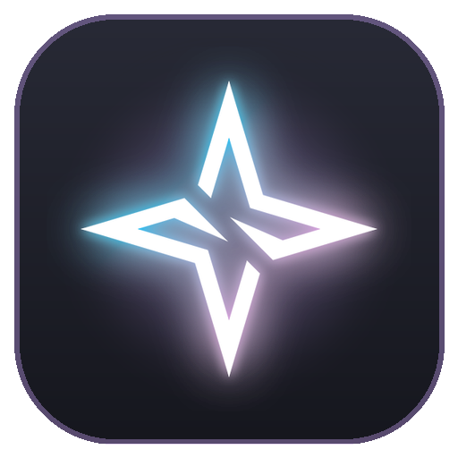

<div align="center">
  
  <h1>Migratify</h1>
  <p>Spotify 계정 간 라이브러리 이전 및 로컬 JSON 백업을 위한 Windows 데스크톱 앱</p>

  <p>
    <a href="https://github.com/x2tora/Migratify/releases/latest">
      
    </a>
  </p>

  <p>
    <a href="https://github.com/x2tora/Migratify/releases/latest">
      
    </a>
    <a href="https://github.com/x2tora/Migratify/releases">
      
    </a>
    <a href="https://github.com/x2tora/Migratify/actions/workflows/release.yml">
      
    </a>
  </p>

  <p>
    <a href="https://github.com/x2tora/Migratify/releases">모든 릴리즈</a>
    &nbsp;·&nbsp;
    <a href="https://github.com/x2tora/Migratify/issues">이슈 제보</a>
  </p>
</div>

---

## 주요 기능

| 기능 | 설명 |
| --- | --- |
| **계정 간 직접 이전** | 플레이리스트, 좋아요 표시한 곡, 저장한 앨범, 팔로우한 아티스트, 팟캐스트를 새 계정으로 복사합니다. |
| **JSON 백업 및 복원** | 보관함 데이터를 로컬 JSON 파일로 내보내고, 다른 계정으로 불러와 복원할 수 있습니다. |
| **세부 항목 제어** | 이전 전 플레이리스트 수록곡 미리보기, 이름·설명 수정, 항목별 선택 및 정렬을 지원합니다. |
| **중복 방지 및 재개** | 기존 항목 중복 건너뛰기, 대용량 트랙 분할 요청, HTTP 429 한도 안내 및 중단 지점 재개를 지원합니다. |
| **보관함 정리** | 선택한 계정의 플레이리스트·저장 항목을 원하는 범위만 선택해 일괄 정리할 수 있습니다. |
| **인앱 업데이트** | 상단 버전 배지에서 GitHub Releases 최신 버전을 확인하고 앱 내에서 바로 다운로드·설치합니다. |

## 시작하기

### 1. 설치

1. 상단의 **Download for Windows** 버튼 또는 [최신 릴리즈](https://github.com/x2tora/Migratify/releases/latest)에서 `Migratify-Setup-x.x.x.exe`를 내려받아 실행합니다.
2. 별도의 유료 EV 코드 서명이 없는 오픈소스 배포본이므로 최초 실행 시 Windows SmartScreen 경고가 나타날 수 있습니다. **추가 정보 → 실행**을 선택해 진행하세요.

### 2. Spotify Developer 앱 설정

1. [Spotify Developer Dashboard](https://developer.spotify.com/dashboard)에서 새 앱을 생성합니다.
2. 앱 설정에서 아래 두 항목을 지정합니다.
   - **Redirect URI**: `http://127.0.0.1:8888/callback`
   - **Which API/SDKs are you planning to use?**: **Web API** 체크
3. 발급된 **Client ID**와 **Client Secret**을 Migratify 1단계에 입력하고 원본/대상 계정을 연결합니다.

## 데이터 처리 및 보안

- Client ID, Client Secret 및 OAuth 토큰은 외부 중계 서버를 거치지 않고 사용자 PC의 로컬 앱 데이터 경로에만 저장됩니다.
- 모든 Spotify API 통신은 로컬 PC에서 공식 엔드포인트(`accounts.spotify.com`, `api.spotify.com`)로 직접 요청됩니다.

## 로컬 개발 및 빌드

Node.js 22+ 및 Python 3.12+ (Windows 빌드 시 리소스 스탬핑용) 환경에서 실행할 수 있습니다.

```bash
npm install
npm run dev       # Vite + Electron 개발 서버
npm test          # Jest 단위 테스트
npm run build     # 프로덕션 번들 빌드
npm run dist      # Windows 설치 파일 생성 (release-dist/)
```

## 안내

Migratify는 독립적인 오픈소스 유틸리티이며, Spotify AB와 제휴, 보증 또는 공식적으로 연관되어 있지 않습니다.
